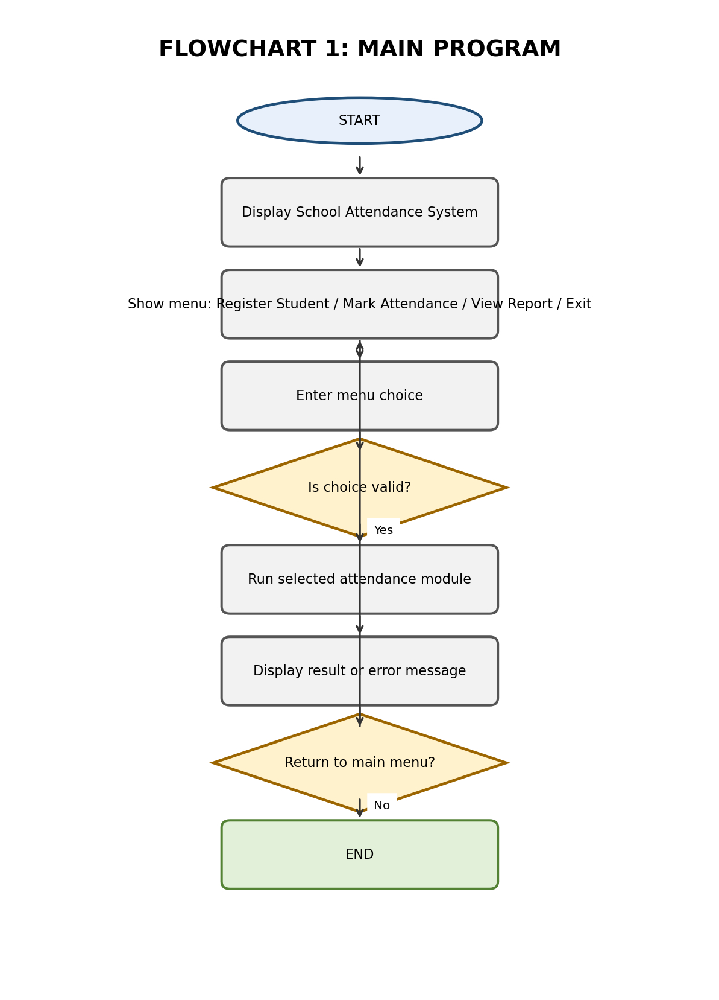
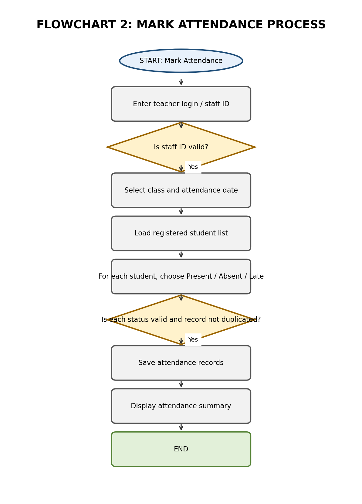

## PROG101_Assignment1_Sulaiman_Kondeh_905006080
This is assignment 1 for Programming Logic and Design about a School Attendance System in S/L 
Project: School Attendance System (SAS)
Student: Sulaiman Kondeh      Student ID: 905006080
Course: PROG101 — Principles of Programming Logic and Design
Institution: Limkokwing University of Creative Technology, Sierra Leone
Examiner: Elijah Fullah

## PROBLEM DESCRIPTION
Many schools need a dependable way to record daily student attendance. When attendance is written only in paper
registers, records may be difficult to search, totals can take time to calculate, and registers may be misplaced or
damaged. Teachers may also find it difficult to identify repeated lateness or absence quickly, especially when several
classes are involved.
The proposed School Attendance Management System is a simple logical solution for recording and reviewing
attendance. It allows an authorised teacher or attendance officer to select a class and date, view the registered
students, and mark each student as Present, Absent, or Late. The system checks that required information is entered,
prevents an attendance record from being saved twice for the same student and date, and stores the result for later
reporting.
The project is a logical design rather than a fully deployed school information system. It does not automatically know
whether a student is physically in class. The teacher remains responsible for checking attendance and entering accurate
information.

## COMMUNITY IMPACT
The proposed system could benefit students, teachers, school administrators, and parents or guardians. Teachers
would have a consistent process for recording attendance, while administrators could review class summaries and
identify attendance patterns that may need attention. Students could benefit when schools identify absence or lateness
early and follow up through appropriate school procedures.
A searchable attendance record could reduce the time spent adding figures from paper registers and preparing routine
summaries. It may also improve accountability because each attendance entry is associated with a student, class, and
date.
The system cannot solve every cause of absenteeism. It cannot replace communication with families, transport support,
health services, or school policies. Its value depends on accurate data entry, responsible access, staff training, and
regular backups. Student information must be kept private and viewed only by authorised people.

## SDG ALIGNMENT
The project mainly supports Sustainable Development Goal 4 (SDG 4): Quality Education. SDG 4 aims to ensure
inclusive and equitable quality education and promote lifelong learning opportunities for all. An organised attendance
record can help a school monitor participation and notice patterns of absence that may require follow-up. This supports
school-level planning, although the system alone cannot guarantee improved attendance or learning outcomes.
The project can also relate to SDG 16: Peace, Justice and Strong Institutions through clearer record-keeping and
accountability in school administration. This connection is indirect: reliable records can support transparent
administrative processes when information is entered and managed responsibly.

## OPEN SOURCE JUSTIFICATION
The proposed system could be developed as Open Source Software so that schools, students, and local developers
can inspect how it works, learn from the design, and contribute improvements. Open access to the source code can
reduce dependence on a single developer and allow the system to be adapted to different school needs, subject to the
chosen software licence.
For Sierra Leone, an open-source approach could support local learning and collaboration. Computing students could
practise improving validation, reports, usability, and data backup. Schools would still need to consider device
availability, staff training, maintenance, privacy, and the cost of operating the system. Open source does not
automatically mean that implementation and support are free.

## ALGORITHM AND PSEUDOCODE
BEGIN

    DECLARE choice AS INTEGER

    DISPLAY "SCHOOL ATTENDANCE SYSTEM"
    DISPLAY "1. Register Student"
    DISPLAY "2. Mark Attendance"
    DISPLAY "3. View Attendance Report"
    DISPLAY "4. Exit"

    REPEAT

        DISPLAY "Enter your choice:"
        INPUT choice

        IF choice = 1 THEN
            CALL RegisterStudent

        ELSE IF choice = 2 THEN
            CALL MarkAttendance

        ELSE IF choice = 3 THEN
            CALL ViewAttendanceReport

        ELSE IF choice = 4 THEN
            DISPLAY "Thank you for using the system."

        ELSE
            DISPLAY "Invalid choice. Please try again."

        END IF

    UNTIL choice = 4

END

BEGIN MarkAttendance

    DECLARE studentID AS STRING
    DECLARE attendanceStatus AS STRING
    DECLARE attendanceDate AS DATE

    DISPLAY "MARK STUDENT ATTENDANCE"

    DISPLAY "Enter Student ID:"
    INPUT studentID

    IF studentID EXISTS IN student records THEN

        DISPLAY "Enter Attendance Date:"
        INPUT attendanceDate

        DISPLAY "Select Attendance Status:"
        DISPLAY "1. Present"
        DISPLAY "2. Absent"

        INPUT attendanceStatus

        IF attendanceStatus = 1 THEN
            SAVE attendance as "Present"

        ELSE IF attendanceStatus = 2 THEN
            SAVE attendance as "Absent"

        ELSE
            DISPLAY "Invalid attendance status."
            RETURN

        END IF

        SAVE studentID, attendanceDate AND attendanceStatus

        DISPLAY "Attendance recorded successfully."

    ELSE

        DISPLAY "Student ID not found."

    END IF

END MarkAttendance

## FLOWCHART
Flowchart 1:Main program and menu navigation

Flowchart 2:Mark Attendance System 

